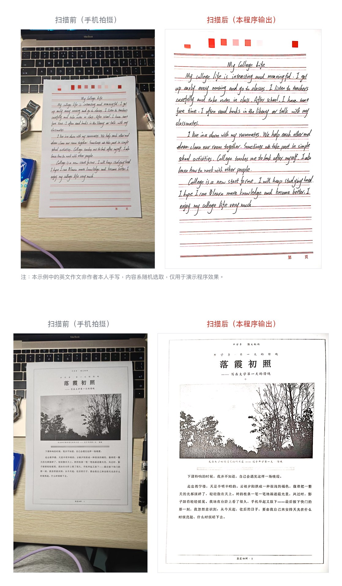

# photo-to-scan

> A free, source-available image scanning tool · **resale prohibited**

> 🌐 **About this English version**
> This document was translated from the Chinese original jointly by the author
> (**hengjunguo35-oss**) and **DeepSeek Harness**.
>
> If you come across awkward phrasing or outright mistakes, please forgive them — and do
> feel free to open an issue or send a pull request. Contributions to both the code and
> the documentation are warmly welcome.
>
> The Chinese version is the authoritative one: **[README.md](README.md)** · [Changelog](CHANGELOG.md)

> ⚠️ **For personal study, research and non-commercial use only. Commercial use requires a
> separate licence.** Please read the [Disclaimer & Terms](DISCLAIMER.en.md) and the
> [LICENSE](LICENSE) (MIT + Commons Clause) before use.

Turn a phone photo of a paper document into a clean scan — the page is detected, the desk and
keyboard are cropped away, perspective and orientation are corrected, shadows are removed and
the paper is pushed to pure white, while **handwriting and the printed red ruling lines are
preserved exactly as raw pixels**.

**No OCR. No re-flowing of text. No generative inpainting.** Handwriting stays as the original
pixels, always.



<sub>Top: a handwritten English essay (sample text chosen at random — not the author's
handwriting). Bottom: a printed document containing an illustration. Both were casual
phone snapshots with no pre-processing.</sub>

---

## Where this came from

11 p.m. Homework is due tomorrow. The assignment: **submit a scanned copy of your handwritten
work.**

So I went looking for a tool. WPS popped up a paywall. The free alternatives either watermarked
the output or — **wanted to upload my homework to someone else's server**. A homework assignment
with my real name on it.

Here I am, a computer science student, and a scan function has me stuck. **Fine. I'll write one.**

I figured it would take an afternoon. It took three days. The trap was in the last step: almost
every scanning tool finishes with **binarisation**, and the red ruling lines on Chinese manuscript
paper sit so close to paper-white in luminance that they get erased outright.

So the program has exactly one iron rule — **never binarise**.

It solved my problem. I hope it solves yours.

---

## Why you can't just use an existing tool

Almost every open-source scanner ends with **adaptive thresholding**
(Sauvola / Wolf / Otsu / unpaper / textcleaner). That's fine for ordinary documents, but it is a
disaster for **Chinese manuscript paper** — the red ruling lines are erased outright.

📖 **For the full design rationale, technology choices and build details, see the
[Technical Documentation](TECHNICAL.en.md)** (Chinese: [技术文档.md](技术文档.md)).

> Turn a phone photo of a paper document into a clean scan: auto paper detection,
> perspective correction, deskew, shadow removal, pure-white background — while
> **preserving handwriting and printed ruling lines as raw pixels**.
> No OCR, no document reconstruction, no generative inpainting.
> macOS 13+, zero third-party dependencies.

## Requirements

- macOS **13.0+** (uses the system Vision document-segmentation API)
- Xcode or Command Line Tools to build (`xcode-select --install`)
- **Zero third-party dependencies at runtime**: system frameworks only
  (Vision / CoreImage / CoreGraphics / ImageIO)
- ⚠️ **Non-ASCII path warning**: the build puts its module cache under `/tmp` on purpose.
  If you point `CLANG_MODULE_CACHE_PATH` / `TMPDIR` at a path containing non-ASCII characters
  (e.g. Chinese), the Swift 5.9 compiler crashes with `SIGILL` (exit 132) and no useful message.
  This was hit for real — see the comments in `app/build-app.sh`.

## Quick start

```bash
# 1. Build the engine
swiftc -O src/scan.swift -o scan

# 2. Process one photo -> PNG + A4 PDF
./scan process photo.jpg output.png --pdf output.pdf

# 3. Batch processing (recommended)
./scan batch output_dir/ photo1.jpg photo2.jpg photo3.jpg
```

### Build a double-clickable app

```bash
./app/build-app.sh          # builds a universal binary (x86_64 + arm64)
open photo-to-scan.app
```

The resulting `.app` supports two workflows:

- **Double-click** → processes every image in `~/Documents/扫描仪/待扫描/`
- **Drag photos onto the icon** → processes that batch immediately

Output lands in `~/Documents/扫描仪/扫描件输出/`; processed originals are archived to `已扫描/`.

> Note: the app's working folder names are in Chinese by default. Set `SCAN_WORKDIR` to use a
> different folder.

## Options

| Option | Default | Description |
|---|---|---|
| `--rot auto\|cw\|ccw\|0\|180` | `auto` | Rotation. `auto` uses projection-variance ratio to decide the axis, then the position of the red heading to choose between 0/180 and cw/ccw |
| `--nodeskew` | off | Disable automatic deskew |
| `--skewgain N` | `1.02` | Deskew threshold: only rotate if the projection variance improves by at least N× |
| `--noflatten` | off | Disable shadow removal / whitening (use when lighting is already even) |
| `--bw` | off | Output a grayscale high-contrast version (red ruling lines turn grey) |
| `--inset N` | `8` | Inset by N pixels on all sides, to remove residual desk colour at the edges |

## Performance: always use `batch`

Vision's document-segmentation model **reloads on every process launch**. Measured on a 2017
Intel Core m3:

| Mode | Time |
|---|---|
| Single photo (`process`) | ~30 s (29 s of which is model loading) |
| 3 photos (`batch`) | **17 s** (model loaded once; ~1 s per additional photo) |

**Use `batch` even for two photos.** On Apple Silicon, model loading is an order of magnitude
faster.

## Pipeline

1. **Find the page** — prefer the printed coloured border on the sheet (pure pixel maths,
   milliseconds; a printed border is a more accurate geometric reference than the paper edge).
   But when the border is incomplete it must be abandoned: `frameQuad` performs a
   **coverage check** and falls back to Vision document segmentation if any edge is below 0.70
   coverage — **better slow than silently cropping the body text**.
2. **Perspective correction** — `CIPerspectiveCorrection`
3. **Auto orientation** — row/column projection-variance ratio decides the text axis; the red
   heading position decides 0/180 and cw/ccw
4. **Auto deskew** — projection-profile method searches ±3° for the shear that maximises the
   ink-row projection variance, removes the residual tilt, then crops the white corners using the
   largest inscribed rectangle. Includes a self-check with revert.
   Measured: **−1.025° → 0.000°**
5. **Shadow removal / whitening** — divide the image by a heavily blurred grayscale copy of
   itself (`CIDivideBlendMode`). Shadows are low-frequency, strokes are high-frequency; the
   division removes the illumination component and leaves reflectance. Note the filter direction
   is "background image = the original" — reverse it and the whole page washes out.
6. `CINoiseReduction` + `CIToneCurve` + `CIColorControls` + `CIUnsharpMask`
7. Inset the edges → 300 dpi PNG + A4 PDF

## Quality verification

```bash
python3 tools/measure.py output.png
```

Three reliable metrics:

- **Residual tilt** should be close to `0.000 deg`
- **Edge outlier ratio** should be < 0.02 (no residual desk colour at the edges)
- **Paper mode** should be 255

The "blank band luma" metric in `measure.py` is contaminated by the red ruling lines crossing the
band — **do not** use it to judge whiteness. And **do not ship on metrics alone**: visually
confirm that the ruling lines are level and the title hasn't been cropped.

## Troubleshooting

| Symptom | What to do |
|---|---|
| Wrong orientation | Force it with `--rot cw` / `--rot ccw` |
| Ruling lines still tilted | Check the `deskew:` line in the log; if `variance gain < 1.02` there genuinely is no line structure |
| Paper looks grey | Check you didn't accidentally pass `--noflatten` |
| Body text was cropped | Page detection drifted. Check the `quad source:` log line — `printed frame` or `Vision document segmentation` |
| Single photo is very slow | Normal (model loading). Use `batch` |

## Repository layout

```
src/scan.swift            Engine (all algorithms and the filter pipeline)
app/applet.applescript    App drag-and-drop / double-click shell
app/scan-worker.sh        Working-directory management, batch dispatch, name collision handling
app/build-app.sh          Packages into a .app (universal binary)
app/make-release.sh       Produces DMG + ZIP + SHA256 checksums
tools/measure.py          Objective quality measurement of the output
docs/                     Demo images and the English technical documentation
```

## Privacy

**Completely offline.** The engine links system frameworks only (no CFNetwork, no
Network.framework); the source contains no network calls whatsoever, and the app's entitlements
are empty. Verified: monitoring the process with `lsof -i` throughout a full scan recorded
**zero network connections**. All of the "intelligence" comes from Apple's on-device models
(CoreML) and local CoreImage operations.

## Commercial licensing & contact

This project is licensed under MIT + Commons Clause, which **prohibits resale**. If you need a
commercial licence (e.g. embedding it in a company product, or offering a paid service), please
get in touch via Issues:

👉 **https://github.com/hengjunguo35-oss/photo-to-scan/issues**

Issues are preferred over email for three reasons:

1. **It doesn't expose the author's email address** to scrapers
2. **It's public**, so others with the same question can benefit
3. **It leaves a record**, which keeps expectations clear on both sides

General questions, bug reports and feature requests are welcome there too.

---

## License

**MIT + Commons Clause** — see [LICENSE](LICENSE).

| | |
|---|---|
| ✅ Permitted | Use, copy, modify, merge, publish, distribute; internal use within a company or organisation; use in personal projects |
| ❌ Prohibited | **Selling** the software, or selling a product or service whose value derives entirely or substantially from its functionality (including paid hosting or support services built around it) |
| ℹ️ | Commercial use requires a separate licence |

> ⚠️ **Note**: because of the Commons Clause restriction, this project is
> **source-available**, not **open source** as defined by the OSI. The two are not the same thing.
